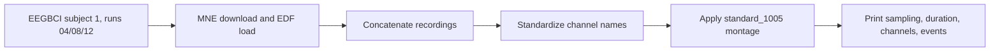

# EEG Motor Imagery Data Inspection

A small MNE exercise that downloads EEGBCI motor-imagery runs, standardizes channel names, applies a montage, and inspects recording metadata and event annotations.

## Results

Verified in this review on subject 1, runs 04, 08, and 12: **64 channels, 160 Hz, 375 seconds, and 90 events**. This is a data-inspection result, not a classifier benchmark; no accuracy is claimed.

## Architecture



## Quickstart and verification

The inspection script ran after the dataset was available. On first use, MNE may prompt for its data directory; accept/set a writable location before continuing.

```bash
python -m pip install mne
python inspect_data.py
```

`fetch_data.py` downloads the same subject/runs if you want to separate acquisition from inspection.

## Limitations

- Only one subject and three runs are inspected.
- The repository explores metadata and events; it does not train/evaluate a decoder.
- MNE dataset download location and prompt behavior can vary by environment.

## Next steps

1. Add a pinned dependency file and a noninteractive dataset-path option.
2. Document event labels and expected run annotations.
3. Add a preprocessing notebook with a clearly separated train/test evaluation.
4. Keep the project positioned as a reproducible data-inspection utility unless a model is added.
